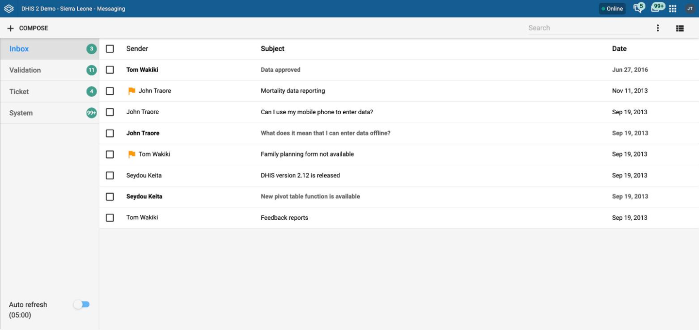
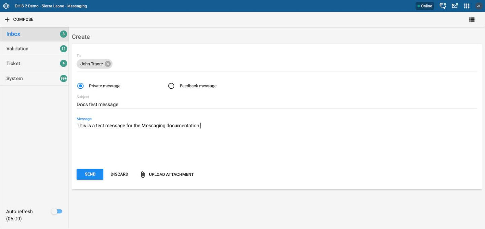
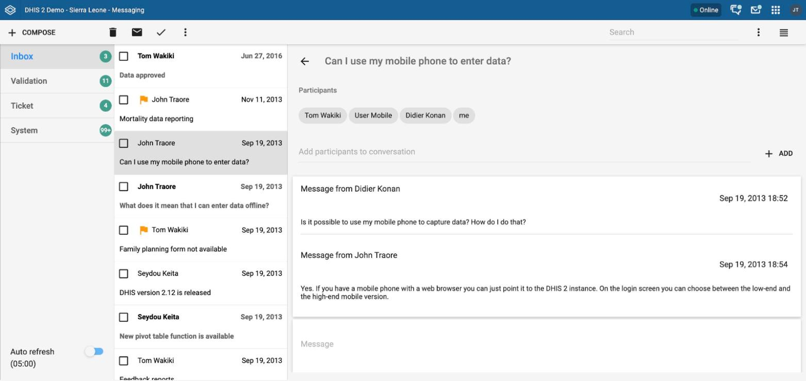
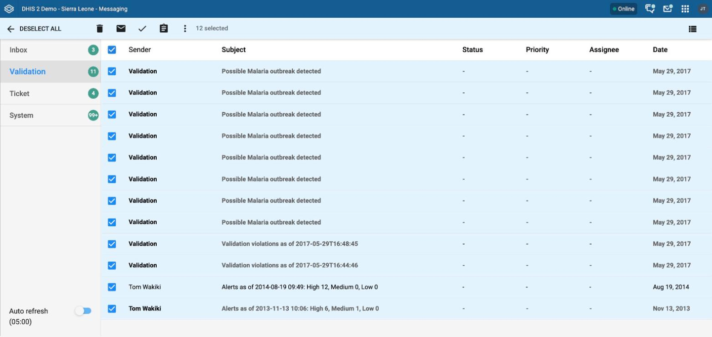
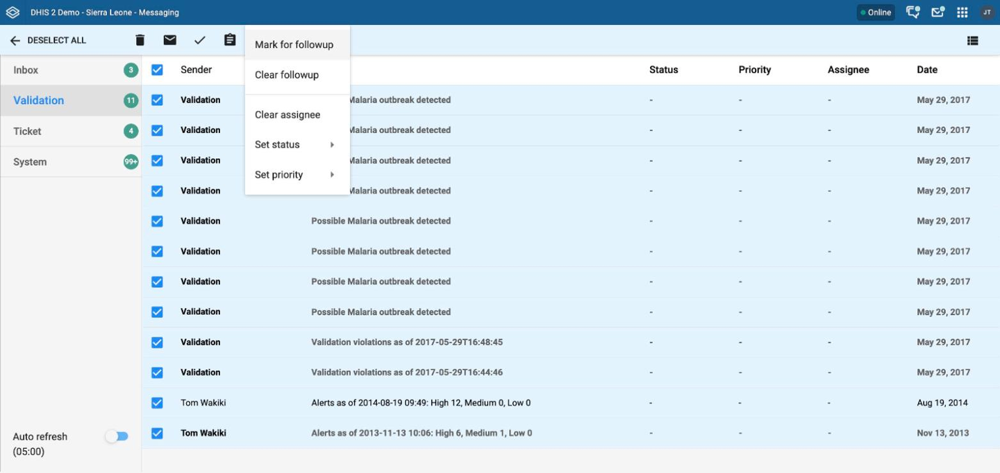

# Messaging { #messages }

## About messages and feedback messages

Within DHIS2 you can send messages and feedback messages to users, user
groups, and organisation units. When you send a feedback message, DHIS2
routes it to a particular user group called the feedback recipient group.
If you are a member of this user group, you have access to feedback
handling tools. You can, for example, set the status of an incoming
feedback message to **Pending** while you are waiting for information.

In addition to the user-to-user and feedback messages, DHIS2 also sends
you system-generated messages, depending on your configuration.
Different events can trigger these messages, including system
or background job failures and validation analysis results. Feedback
handling tools are also available for validation results. DHIS2 sets the
priority to the importance of the validation rule that was violated.

To open the app, click the **message icon in header bar** or find the
**Messaging** app in the app search box.

> **Note**
>
> Messages and feedback messages always appear within DHIS2. If the
> system e-mail server is configured, DHIS2 can also send them by
> e-mail to users who have turned on message e-mail notifications in
> their user settings.
>
> v30 introduced a new Messaging app, which offers a richer
> messaging experience. It has these features:
>
> -   Switch between list view and compact view by clicking the icon in
>     the top right corner.
>
>     -   The list view is simple and gives a good
>         overview of all messages. It is especially suited for feedback and
>         validation messages.
>     -   The compact view shows
>         more information in one view, so it is easier to view and reply to
>         several messages.
>
>     The first screenshot in this section shows the list view, and the
>     screenshot in the section **Read a message** shows the compact
>     view.
>
> -   A search field lets you search for
>     messages. The search filters messages by subject, text, and
>     senders. You can narrow down the message conversation list by
>     entering a search.
>
> -   An auto refresh feature fetches new
>     messages every 5 minutes. This feature is
>     disabled by default.
>
> -   In every message conversation, you can add participants. This is
>     useful if you want input on that
>     conversation or if someone else should see the
>     information. You cannot delete participants from a
>     conversation.

## Create a message

1.  Click **Compose**.

2.  Define who you want to receive the message. You can send a message
    to organisation units, users, and user groups.

    -   In the **To** field, search for organisation units, users, or
        user groups, and choose the recipients that you want.

3.  Type a subject and a message.

4.  Click **Send**.

## Read a message

1.  Choose the message type that you want on the left.

2.  Click a message.

    If the message is part of a conversation, the app shows all messages in
    this conversation.

## Create a feedback message

1.  Follow the steps to create a message, but choose
    **Feedback message** instead of entering recipients.

2.  DHIS2 creates the message as a feedback message. It appears in
    the **Ticket** folder of the users in the feedback recipient group.

## Attachments

v31 introduced attachments to messages. When you create or
reply to a message conversation, you can add
attachments. DHIS2 blocks some file types, such as executable and web
files (for example .exe, .html, and .js). By default, DHIS2 rejects files
larger than 10 MB. A system administrator can change this limit with
the `max.file_upload_size` server setting.

## Manage validation and feedback messages

> **Note**
>
> You see feedback messages and have access to the extended
> handling tools only if you are a member of the user group that is set up to
> handle feedback messages.
>
> In the Messaging app, you manage extended tools for tickets and validation
> messages through the icon menu. The icon menu appears when you view a
> message or when you check messages in the conversation list.

### All messages selected

### All messages selected and extended choice picker selected

Feedback messages arrive in your **Ticket** folder, and
validation messages arrive in your **Validation** folder. For feedback and
validation messages, you have the following options in addition to the
options for messages:

<table style="width:100%;">
<caption>Feedback handling tools</caption>
<colgroup>
<col width="23%" />
<col width="76%" />
</colgroup>
<thead>
<tr class="header">
<th>Function</th>
<th>Description</th>
</tr>
</thead>
<tbody>
<tr class="odd">
<td>
<strong>Priority</strong>
</td>
<td>
You can mark a feedback or validation message with different priorities: <strong>No priority</strong>, <strong>Low</strong>, <strong>Medium</strong>, or <strong>High</strong>.

Setting the priority makes it easier to keep track of which feedback messages you need resolved first and which feedback messages can wait.
</td>
</tr>
<tr class="even">
<td>
<strong>Status</strong>
</td>
<td>
All feedback and validation messages get the status <strong>Open</strong> when created.

To keep track of existing feedback messages, you can change the status to <strong>Pending</strong>, <strong>Invalid</strong>, or <strong>Solved</strong>.

You can filter feedback and validation messages by status and priority with the <strong>Status</strong> and <strong>Priority</strong> drop-down menus in the internal header bar.
</td>
</tr>
<tr class="odd">
<td>
<strong>Assignee</strong>
</td>
<td>
You can assign a feedback message to any member of the user group that is set up to handle feedback messages.

You can assign a validation message to any user in the system.

<strong>-</strong> means that you have not assigned a user to the feedback message.
</td>
</tr>
<tr class="even">
<td>
<strong>Internal reply</strong>
</td>
<td>
When you work in a feedback handling team, you might want to discuss the feedback before you send an answer to the sender. You can keep this discussion in the same message conversation as the feedback itself.

To send a reply within the feedback handling user group, click <strong>INTERNAL REPLY</strong>.
</td>
</tr>
</tbody>
</table>

## Configure feedback message function

To configure the feedback message function:

1.  Create a user group (for example "Feedback message recipients") that
    contains all the users who should receive feedback messages.

2.  Open the **System Settings** app, click **General** \> **Feedback
    recipients**, and choose the user group that you created in the previous
    step.
